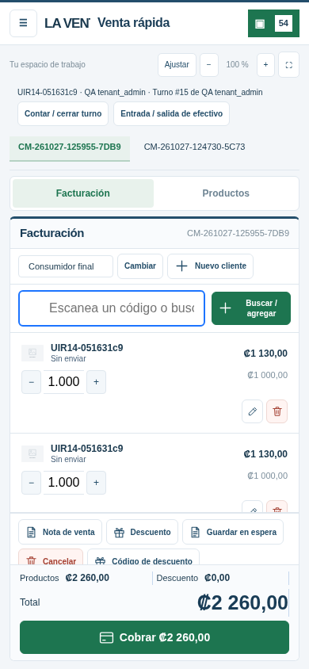
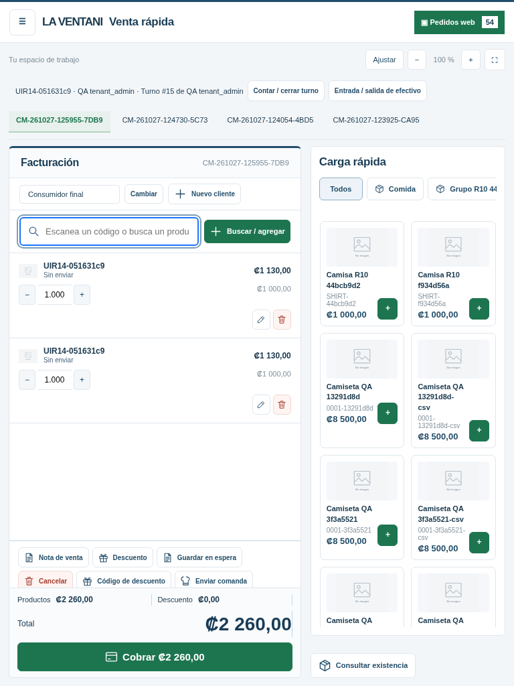
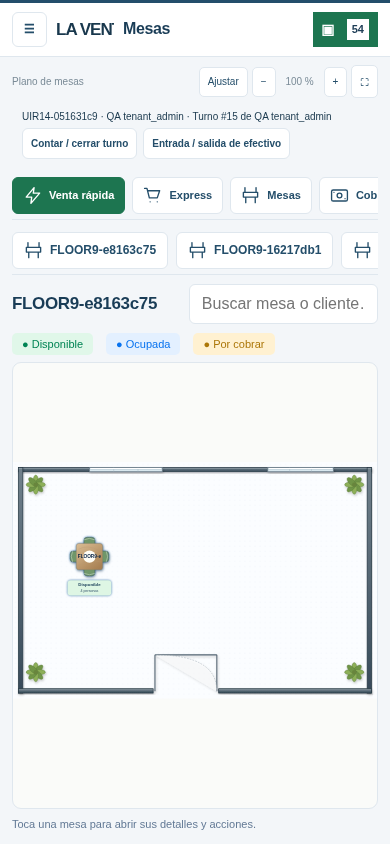
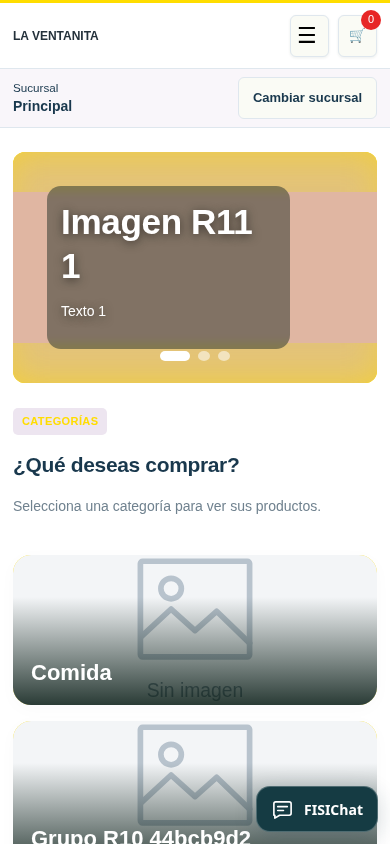

# Diseño aplicado en FISITAAP web R14

Capturas de la aplicación PHP con datos ficticios de prueba. El paquete se instala sobre la aplicación real y conserva su base de datos.

## Venta rápida en celular

Facturación y Productos se alternan; los importes se ven completos y el cobro permanece dentro de la pantalla.

## Venta rápida en tableta

La factura ocupa la izquierda con el 60 % del espacio; la carga rápida queda a la derecha.

## Mesas en celular

El plano conserva las mesas, sillas y objetos guardados. Se puede acercar o ajustar; seleccionar una mesa permite continuar su cuenta.

## Catálogo en celular

La tienda mantiene su color primario y el menú de compras.

[Descargar actualización R14](https://raw.githubusercontent.com/fisitalmultiservicios-svg/FISITAAP/main/descargas/1.8.0/FISITAAP-1.8.0-CPANEL-R14.zip) · [Instalación](GUIA-CPANEL-1.8.0.md) · [Resultados y alcance de las pruebas](INFORME-QA-1.8.0.md)
