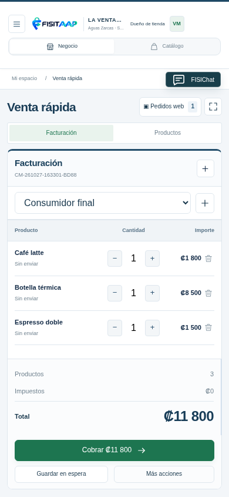
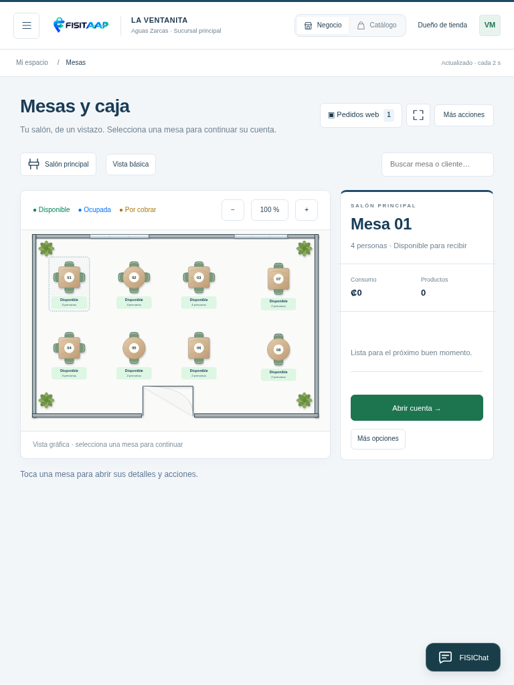
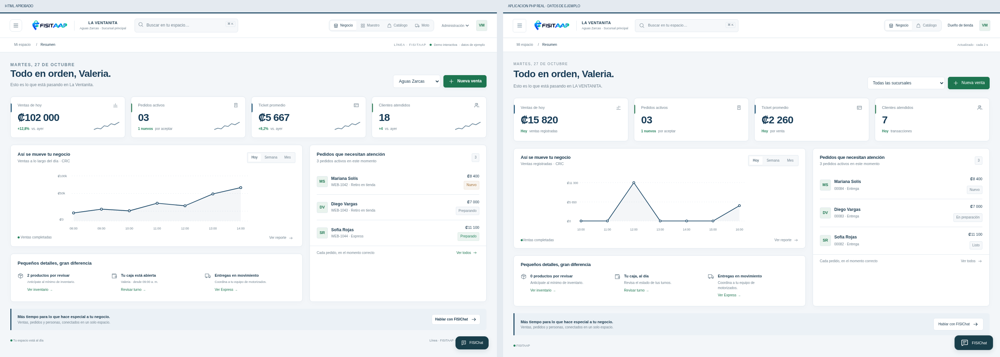

# R15: el HTML aprobado y la aplicación real

Estas comparaciones muestran el **HTML Línea + FISITAAP a la izquierda** y la **aplicación PHP real a la derecha**, con datos ficticios. Ya se integran la estructura y los estilos del HTML. Las cifras provienen de cada versión y pueden diferir; el sitio real usa sus propios registros, permisos y salón guardado.

| Pantalla | Computadora | Tableta | Celular |
|---|---|---|---|
| Resumen | [Comparar 1440 px](R15-COMPARAR-RESUMEN-1440.png) | [Comparar 768 px](R15-COMPARAR-RESUMEN-768.png) | [Comparar 390 px](R15-COMPARAR-RESUMEN-390.png) |
| Venta rápida | [Comparar 1440 px](R15-COMPARAR-VENTA-1440.png) | [Comparar 768 px](R15-COMPARAR-VENTA-768.png) | [Comparar 390 px](R15-COMPARAR-VENTA-390.png) |
| Mesas gráficas | [Comparar 1440 px](R15-COMPARAR-MESAS-1440.png) | [Comparar 768 px](R15-COMPARAR-MESAS-768.png) | [Comparar 390 px](R15-COMPARAR-MESAS-390.png) |

## Factura real en celular

## Mesas reales en tableta

## Resumen: comparación en computadora

La factura ocupa la izquierda y la carga rápida la derecha en computadora/tablet; en celular usa pestañas. El total y Cobrar permanecen dentro de la pantalla. El detalle de mesa queda al lado del plano y se apila debajo en celular. Las mesas de ejemplo de las capturas no se instalan en ningún negocio.

La demo permite alternar perfiles para explorar ideas. La aplicación muestra sólo los espacios autorizados de la cuenta que inició sesión. Conserva los controles nativos, los permisos para cobrar/cancelar y los estados reales de cocina. Resumen y Bienvenida permanecen separados.

[Descargar R15](https://raw.githubusercontent.com/fisitalmultiservicios-svg/FISITAAP/main/descargas/1.8.0/FISITAAP-1.8.0-CPANEL-R15.zip) · [Guía](GUIA-CPANEL-1.8.0.md) · [QA](INFORME-QA-1.8.0.md)

Las capturas corresponden a PHP/MariaDB/Chromium local; no demuestran instalación en el hosting ni sustituyen la revisión en dispositivos físicos. La web oficial de presentación conserva su apariencia.
