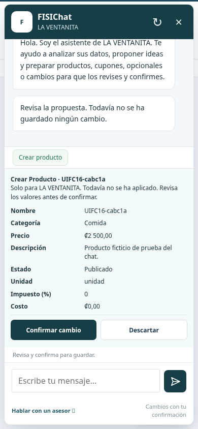
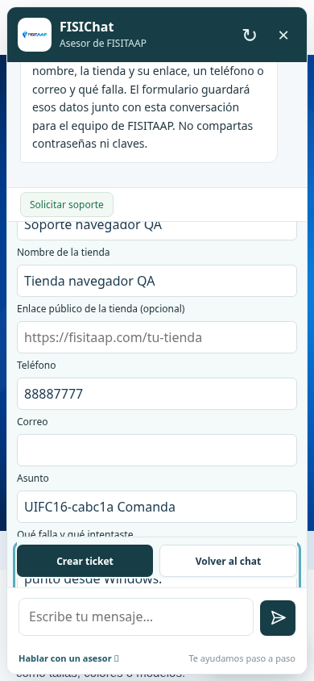
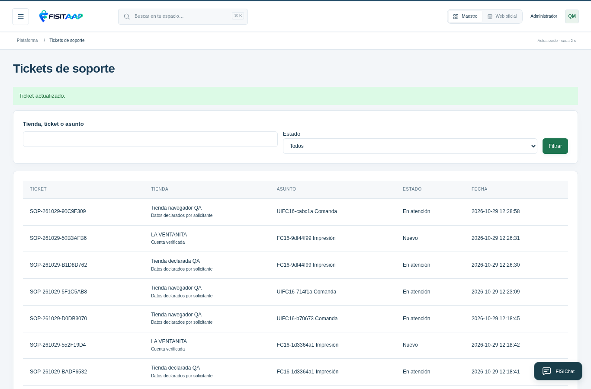

# R16: FISIChat y catálogo compacto

Capturas de la aplicación PHP real en un entorno local con datos ficticios. Los nombres, teléfonos y productos de prueba no corresponden a tu instalación. Cada tienda conserva su color y fotografías; el amarillo es una configuración del fixture de prueba.

## Cambios revisables del dueño

La propuesta muestra tienda, categoría, precio y demás datos antes de guardar. Confirmar cambio aplica la operación; Descartar la deja sin aplicar. El modelo puede preparar la propuesta, pero no confirmar por el usuario.

## Soporte de la web oficial

Cuando el caso continúa, solicita tienda, contacto y descripción. Solicitar soporte también abre el formulario. Crear ticket devuelve una referencia persistente, sin mensajes externos automáticos.

## Bandeja del maestro

Administración → Tickets de soporte permite revisar contactos, tienda, conversación, estado y notas internas. Distingue cuentas dueñas verificadas de datos declarados por solicitantes anónimos.

## Catálogo con tarjetas más pequeñas

[Ver catálogo en computadora](R16-CATALOGO-COMPUTADORA.png) · [Ver catálogo en celular](R16-CATALOGO-CELULAR.png)

Cinco columnas en pantalla amplia, cuatro en computadora mediana, tres en tablet y dos en celular; imágenes y espacios reducidos. El carrito y las cantidades se conservan. Los banners/configuraciones de ejemplo y fotografías existentes no se reemplazan por esta actualización.

[Descargar R16](https://raw.githubusercontent.com/fisitalmultiservicios-svg/FISITAAP/main/descargas/1.8.0/FISITAAP-1.8.0-CPANEL-R16.zip) · [Guía](GUIA-CPANEL-1.8.0.md) · [QA](INFORME-QA-1.8.0.md)

Estas capturas no demuestran instalación en el hosting ni sustituyen la revisión de tu conexión real de IA o tus dispositivos.
