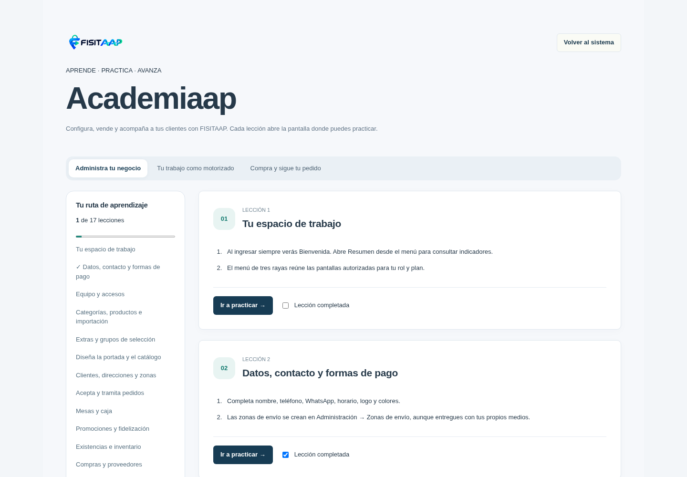
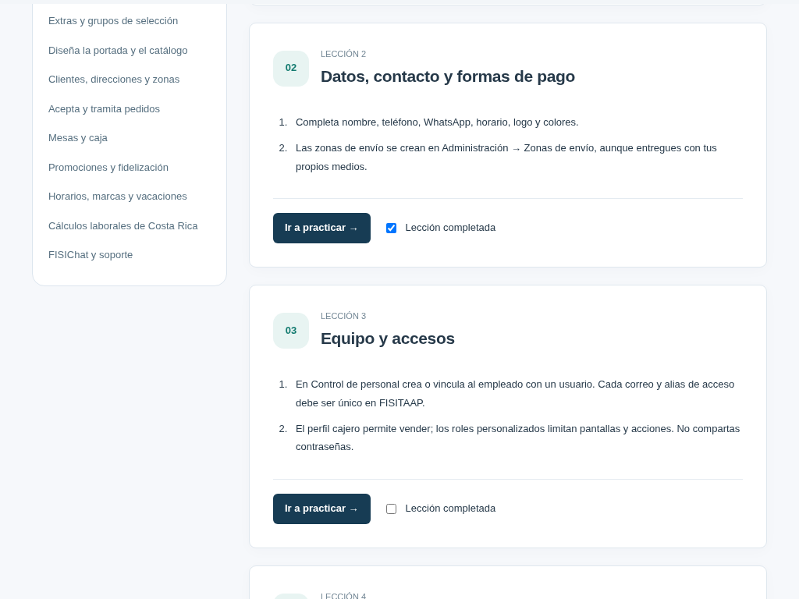
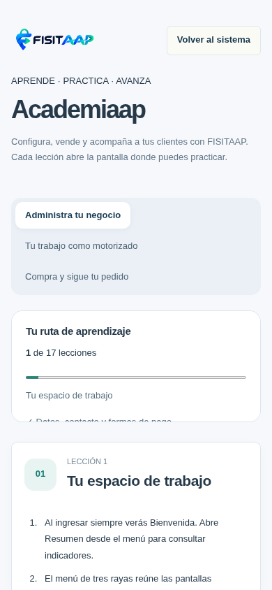
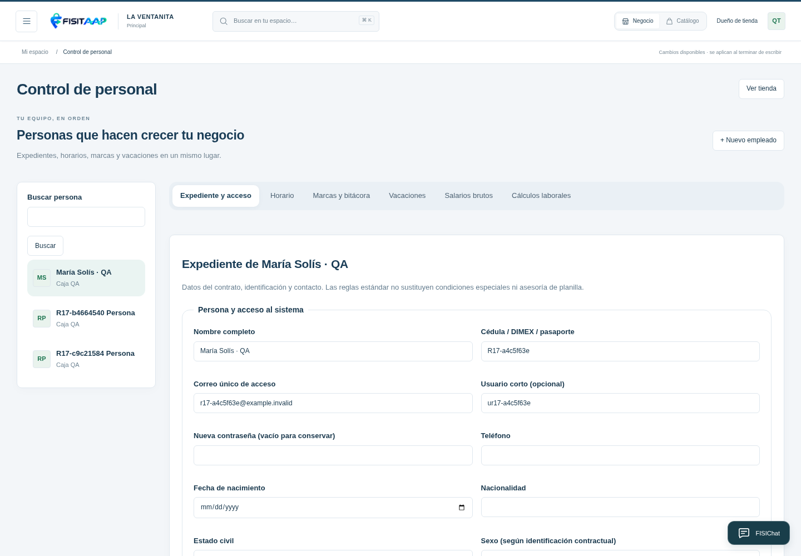
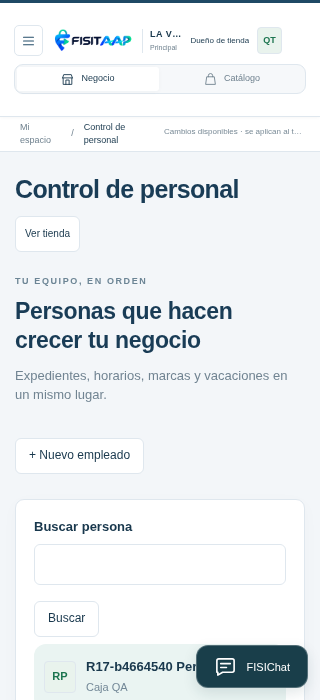
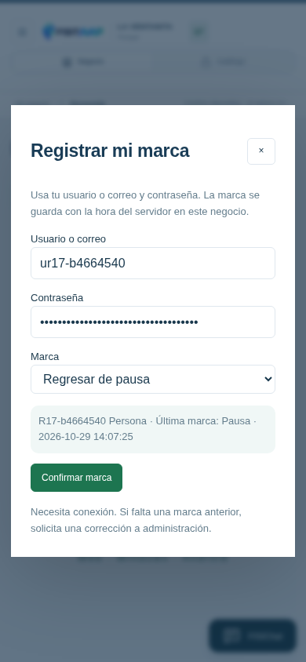
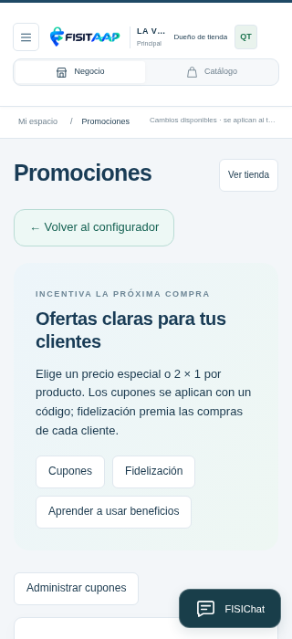
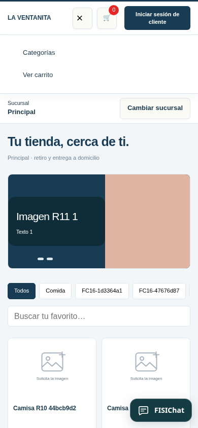

# Vistas R17

Capturas del entorno de pruebas con datos ficticios. Conserva el diseño Línea + FISITAAP y comprueba adaptación de 320 a1440px. No son capturas del hosting público.

## Academiaap

Lecciones con progreso y práctica en pantallas reales; el botón Volver al curso conserva el recorrido.

## Control de personal

Expediente y pestañas de horario, marcas, vacaciones, salarios y estimaciones. En celular el listado se ubica antes del expediente.

## Marcar dentro de la aplicación instalada

Cada persona usa sus credenciales. La captura muestra la consulta previa; ninguna marca se guardó desde esa captura. Las comprobaciones de servidor verificaron equipo, secuencia e idempotencia mediante el protocolo nativo de prueba. Los dispositivos físicos requieren comprobación en la instalación.

## Promociones

## Menú del comprador

Acciones de compras y acceso del cliente, sin los enlaces antiguos Inicio/Blog/Contacto.

Consulta [guía](GUIA-CPANEL-1.8.0.md) e [informe](INFORME-QA-1.8.0.md). Cálculos laborales: estimaciones para revisión, sin validación jurídica vigente desde este entorno.
