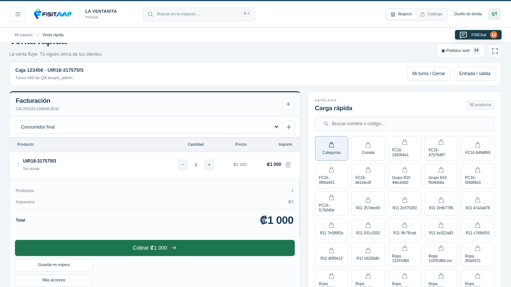
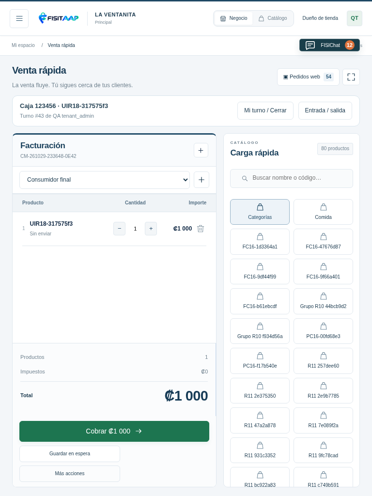
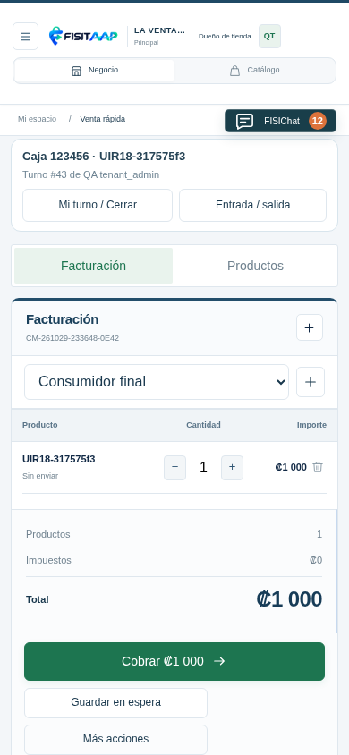
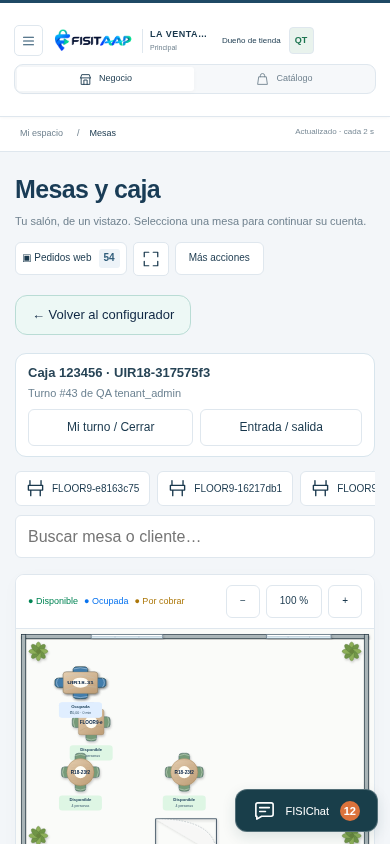
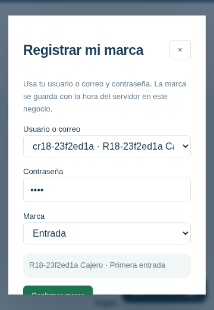
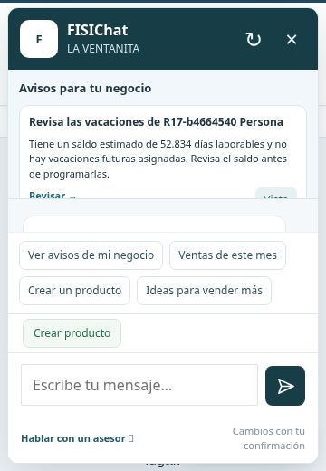

# Vistas R18

Capturas de QA local con datos ficticios, después de acciones reales en PHP/MariaDB. No son capturas del hosting.

## Venta rápida

Factura izquierda más grande, cliente y botones accesibles; Caja y turno siempre visible. En celular, Facturación/Productos. Si falta altura, la página permite desplazarse y el área de productos tiene su propio desplazamiento.

## Mesas

Plano con proporciones conservadas y zoom. Tocar una mesa normal abre su cuenta en la pantalla de productos.

## Personal y FISIChat

Selector para marcar dentro de la aplicación instalada y avisos propios del dueño. Los datos mostrados son ficticios.

