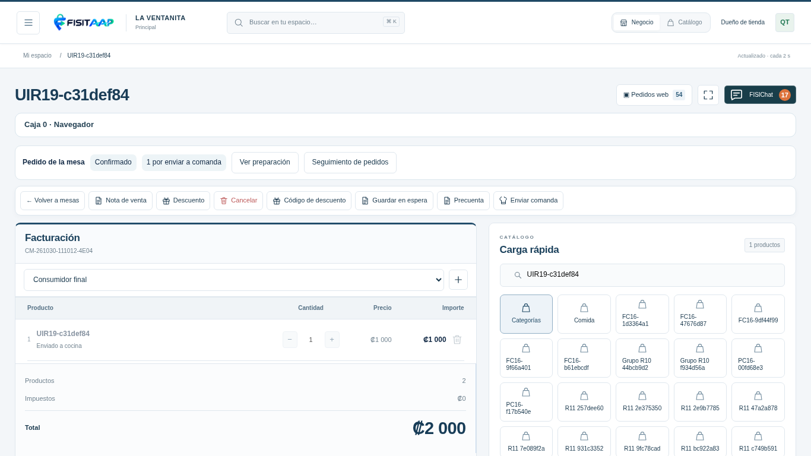
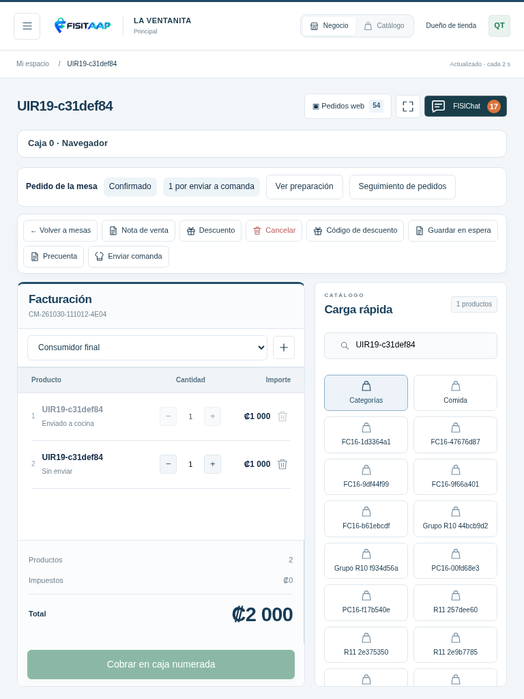
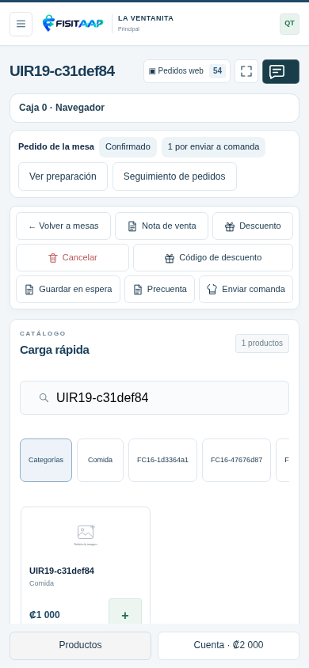
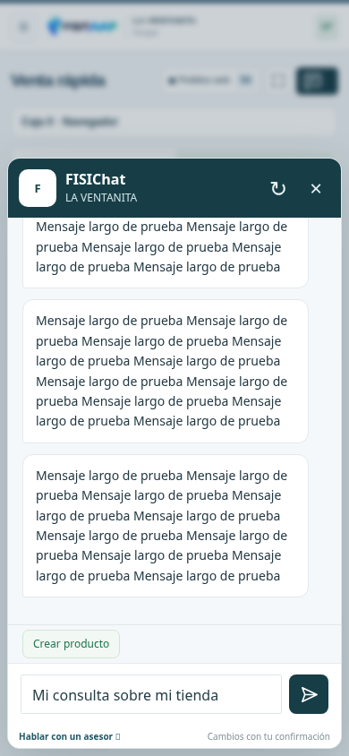
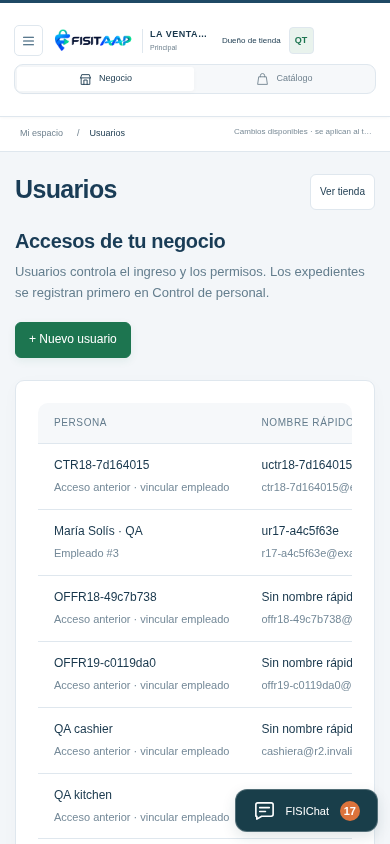
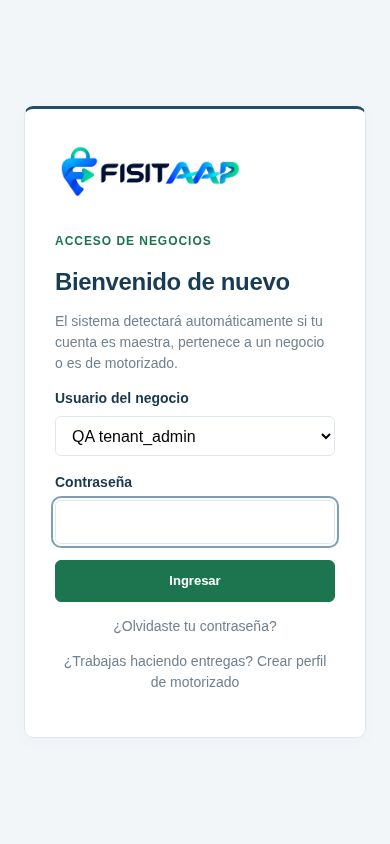

# Vistas R19

QA local con personas, pedidos y productos ficticios. No son capturas del hosting público.

## Mesas y botones visibles

Cuenta y carga de productos en el mismo lugar; comanda, precuenta y seguimiento accesibles. En celular, una página con Productos/Cuenta y acciones fijas.

## FISIChat

En la capa modal por encima de la aplicación, con conversación desplazable y cuadro de escritura visible. Se insertó historial ficticio para probar el desplazamiento, sin consultar una IA externa.

## Usuarios

Lista independiente de accesos y selector conectado del negocio, sin reutilizar la lista antigua de prueba.

