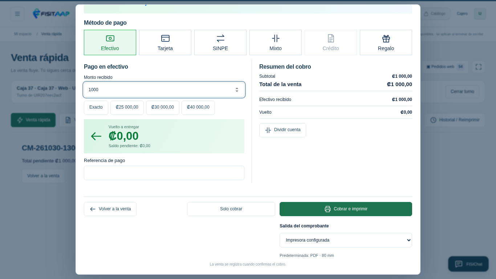
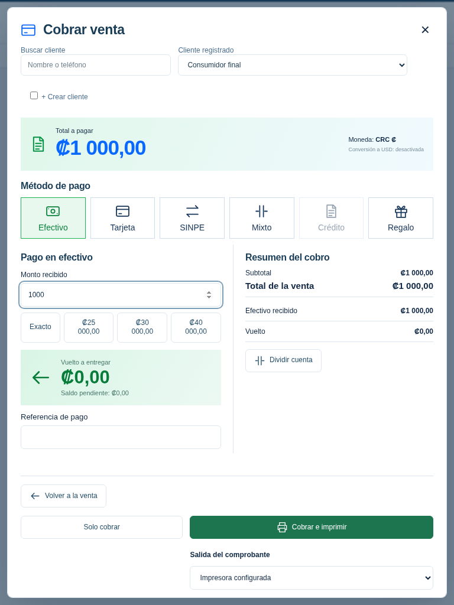
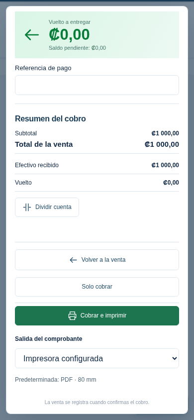

# Cobro R20

Capturas locales con tienda y cobros ficticios. Muestran la parte inferior de la ventana, desplazada hasta los controles de confirmación. La cabecera y los medios de pago se alcanzan desplazando dentro de la misma ventana.

Dos botones independientes y la salida debajo de Cobrar e imprimir. En celular se apilan a todo el ancho y el resumen se ordena en una columna.

