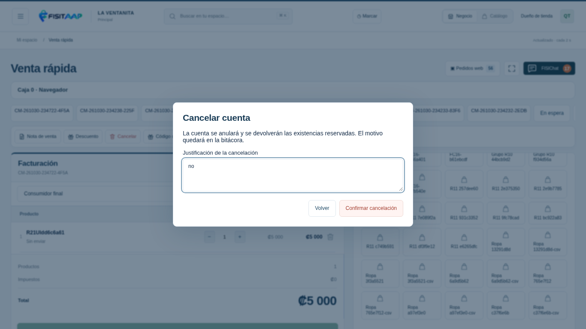
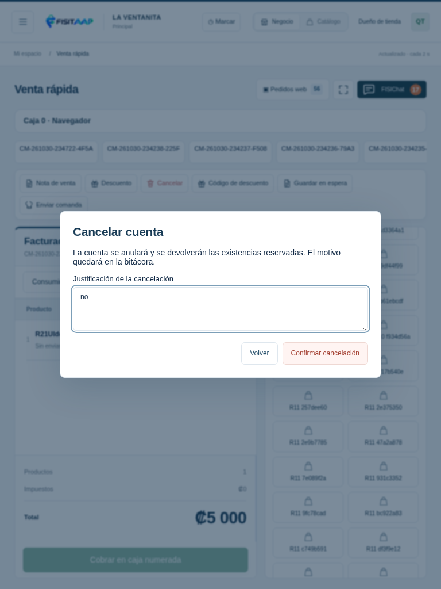
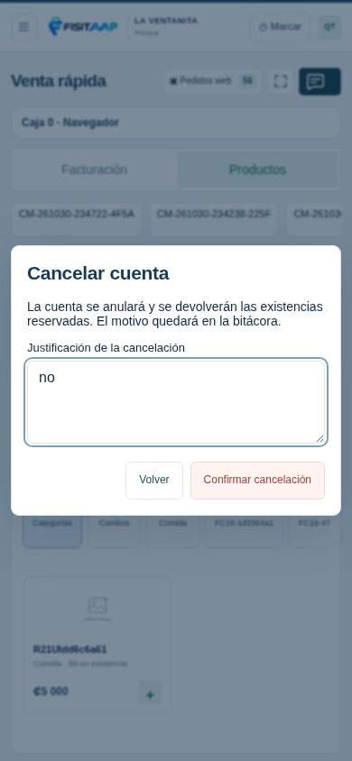

# Justificación de cancelación R21

Capturas de una tienda ficticia en la aplicación web, con el puente instalado simulado. El campo se muestra dentro de la ventana y exige un motivo de al menos 8 caracteres. Volver cierra sin cancelar; Confirmar cancelación envía el motivo al servidor, que verifica los permisos.

