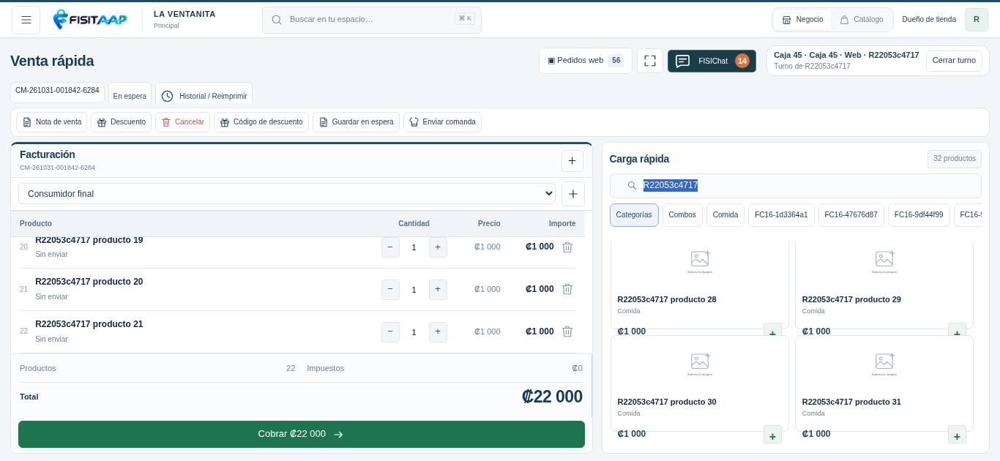
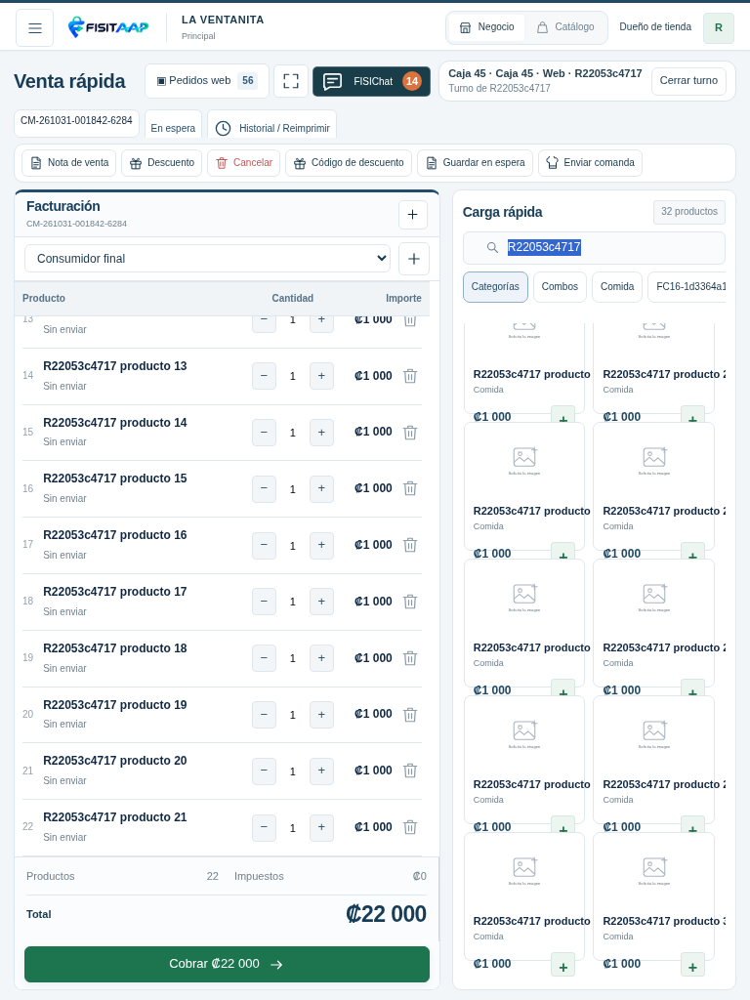
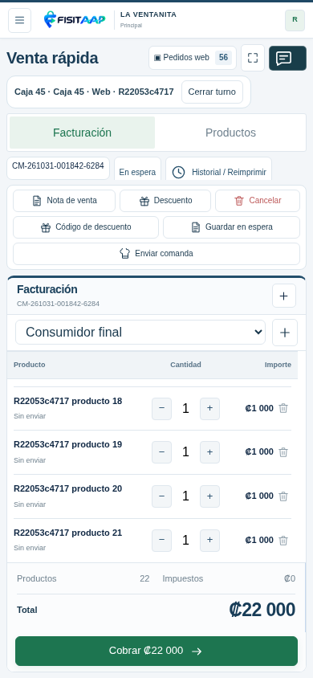
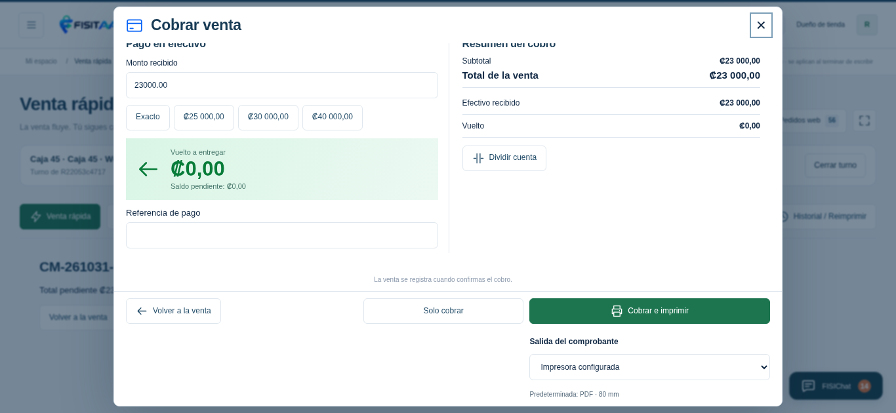
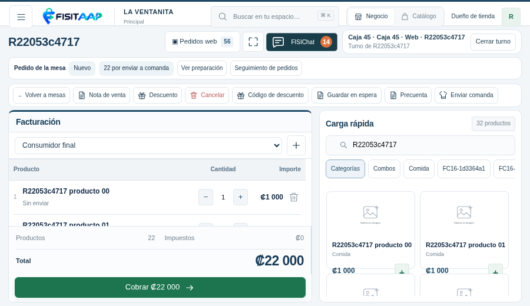
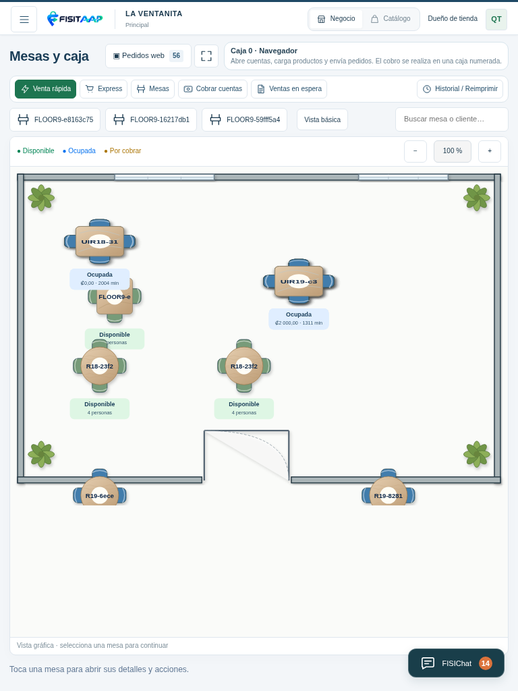

# Encuadre de Venta rápida y Mesas · R22

Capturas de pruebas locales con una tienda ficticia. La cabecera y caja ocupan menos alto; la factura conserva el panel izquierdo más grande. Total y Cobrar permanecen en el marco y las listas largas se desplazan dentro de sus paneles.

La primera captura usa una ventana de 1366 × 630, equivalente al espacio reducido disponible dentro del programa instalado. No es una fotografía de un monitor Windows real.

El cobro mantiene la cabecera, las dos confirmaciones y la salida del comprobante dentro de la ventana. El cuerpo está desplazado hasta el final en esta captura.

El plano conserva sus proporciones y los controles para acercar, alejar y ajustar.

