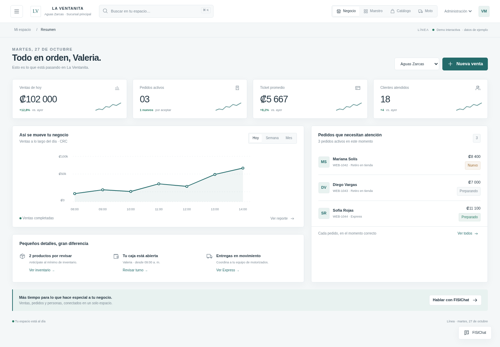
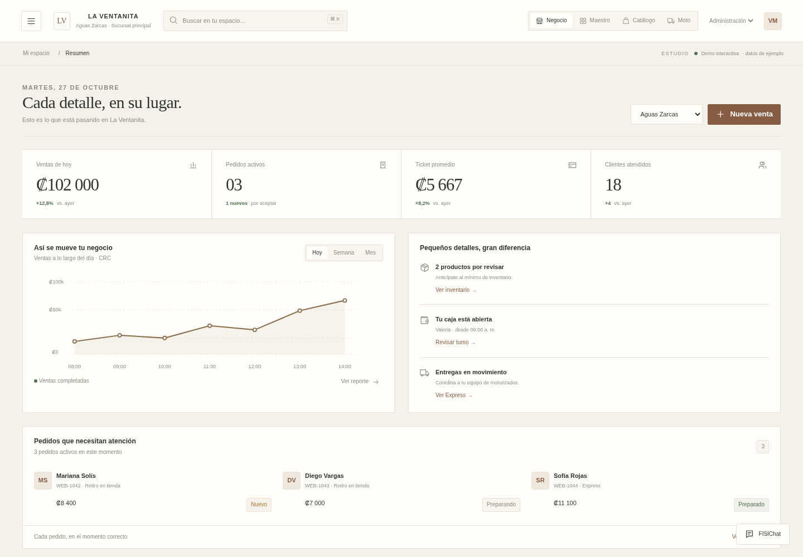
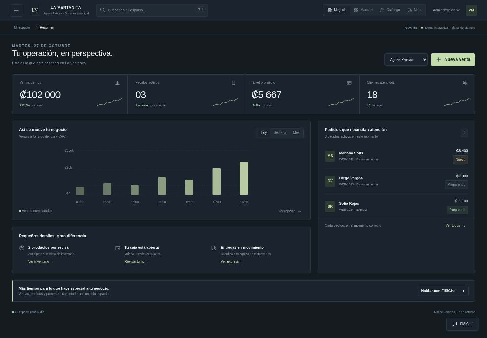

# Tres diseños UX de FISITAAP

**[Descargar los tres diseños en un ZIP](https://raw.githubusercontent.com/fisitalmultiservicios-svg/FISITAAP/main/descargas/disenos-ux/FISITAAP-TRES-DISENOS-UX-2026-10-27.zip)**. Descomprime y abre **index.html** para compararlos.

| Línea | Estudio | Noche |
| --- | --- | --- |
|  |  |  |
| Clara y sobria, blanco y petróleo. | Cálida y editorial, marfil y tonos tierra. | Compacta y oscura, grafito y salvia. |
| [Descargar HTML](https://raw.githubusercontent.com/fisitalmultiservicios-svg/FISITAAP/main/descargas/disenos-ux/01-linea.html) | [Descargar HTML](https://raw.githubusercontent.com/fisitalmultiservicios-svg/FISITAAP/main/descargas/disenos-ux/02-estudio.html) | [Descargar HTML](https://raw.githubusercontent.com/fisitalmultiservicios-svg/FISITAAP/main/descargas/disenos-ux/03-noche.html) |

Cada HTML es independiente e incluye imágenes, estilos y lógica. GitHub muestra su código: **descarga el archivo y ábrelo en el navegador** para usarlo.

Incluyen Negocio, Maestro, Catálogo y Moto, con ventas, productos, pedidos, mesas y entregas que funcionan con datos ficticios guardados en el navegador. Son prototipos para elegir una interfaz; la web oficial de presentación y la instalación actual siguen intactas.

[Guía de uso, recorridos y alcance](LEEME.md) · [Detalle de pruebas](QA.json) · [Huellas de archivos](SHA256SUMS.txt)
