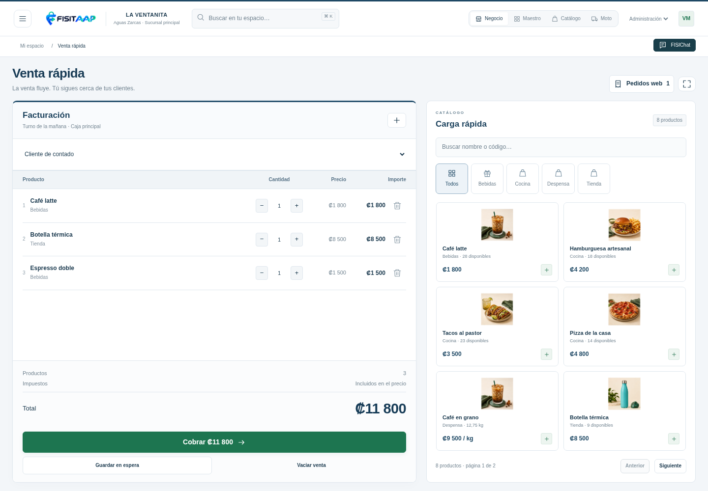
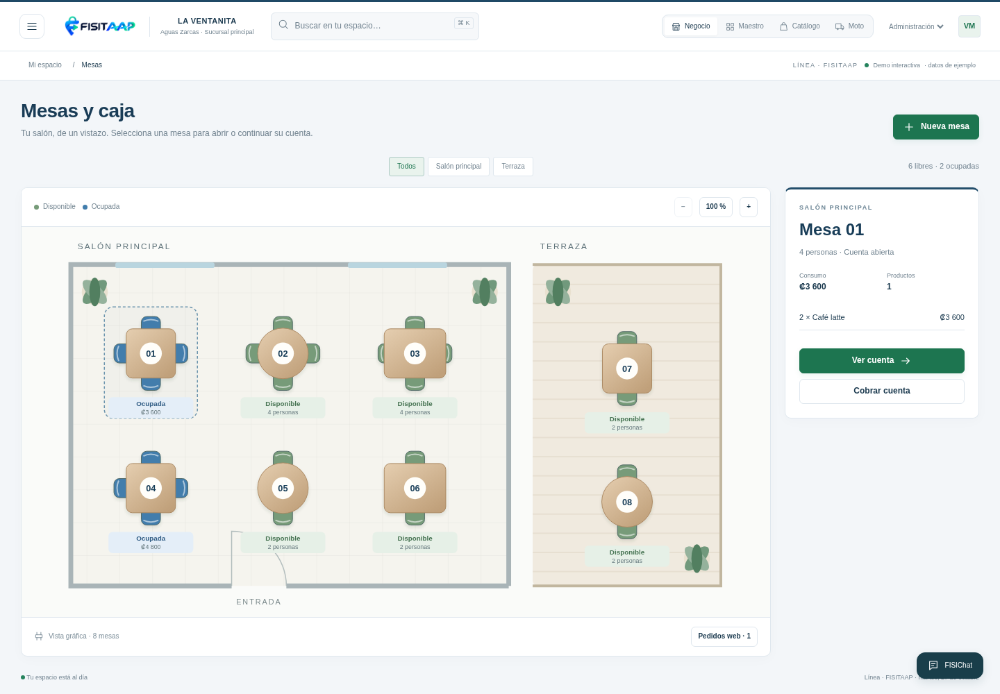
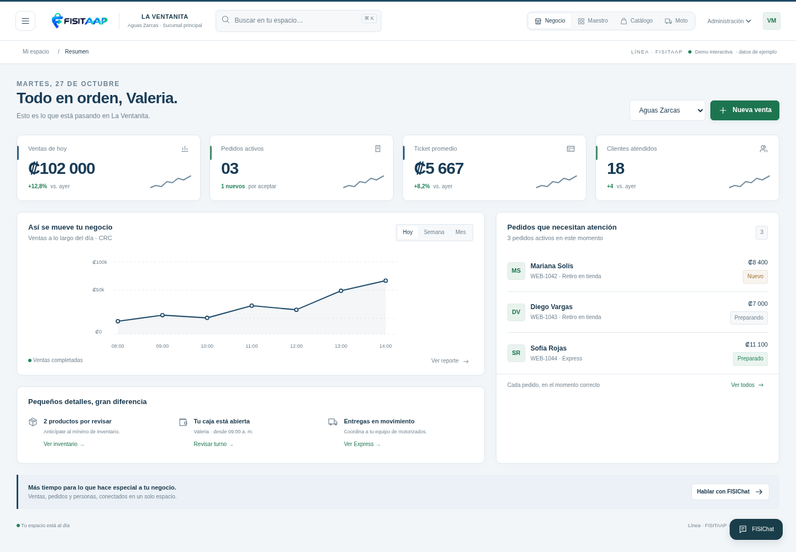

# Línea con la identidad de FISITAAP

**[Descargar el prototipo completo en ZIP](https://raw.githubusercontent.com/fisitalmultiservicios-svg/FISITAAP/main/descargas/linea-fisitaap/FISITAAP-LINEA-MEZCLA-UX-2026-10-27.zip)**. Descomprime y abre **index.html**.

Combina los espacios y la limpieza de Línea con el logo, azul profundo y verde de FISITAAP. Es un prototipo interactivo con datos locales; la instalación actual y la web de presentación permanecen intactas.

### Venta rápida

Facturación a la **izquierda, con el 60 % del espacio**. Categorías y productos de carga rápida a la derecha, con el 40 %. En celular se alternan las pestañas Facturación y Productos.

### Mesas y caja

Se conserva el plano gráfico con mesas, sillas, estados y detalle de la cuenta. Permite seleccionar, abrir y cobrar mesas, filtrar salones y acercar el plano.

### Resumen del negocio

[Guía y alcance](LEEME.md) · [Pruebas](QA.json) · [Descargar solo el HTML](https://raw.githubusercontent.com/fisitalmultiservicios-svg/FISITAAP/main/descargas/linea-fisitaap/index.html)

GitHub muestra el código del HTML: descárgalo y ábrelo en el navegador para interactuar.
